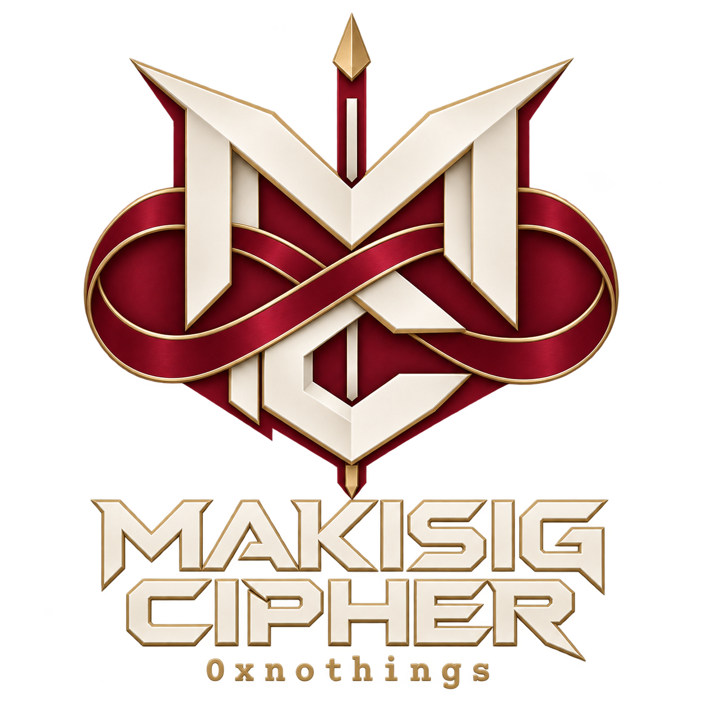

  

<h1 align="center">Makisig Cipher</h1>

  <strong>Developer · Builder · Curious mind</strong> 
  <code>@0xnothings</code>

  <em>From nothing, to something, to everything.</em>

  <a href="https://github.com/0xnothings?tab=repositories">Explore my projects</a>
  &nbsp;·&nbsp;
  <a href="https://github.com/0xnothings?tab=stars">Things I find interesting</a>

---

### About me

I'm **Makisig Cipher**, also known as **0xnothings**.

I enjoy turning ideas into useful tools, exploring how systems work, and learning through building.

- **Build** — practical tools and web projects.
- **Automate** — repetitive tasks and everyday workflows.
- **Explore** — code, systems, and new ideas.

---

  <em>Think clearly. Build carefully. Keep learning.</em>

